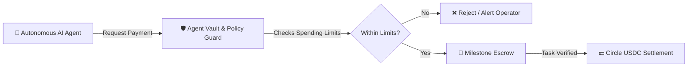

# ⚡ Arc USDC Agent Pay

[](https://opensource.org/licenses/MIT)
[](https://www.circle.com/usdc)
[](https://www.python.org/)

**Autonomous USDC Micro-Payment & Milestone Escrow Engine for AI Agents.**  
Built for the **Circle USDC** and **Arc** ecosystem.

---

## 🎯 The Problem
Autonomous AI agents are increasingly capable of hiring services, paying for inference, purchasing datasets, and trading computation. However:
- Traditional crypto wallets give agents full unconstrained private key access — risking 100% wallet drain upon hallucination or jailbreak.
- Agents require **hard velocity bounds**, **daily spending caps**, **whitelisted recipient routing**, and **milestone-based escrow** before releasing funds.

## ✨ Key Features
- 🛡️ **Policy-Governed Agent Vaults**: Hard-coded constraints on maximum transaction size, daily spending budgets, and lifetime velocity.
- 🤝 **Two-Sided Milestone Escrow**: Funds are locked until acceptance criteria (verifiable API responses, test results) are confirmed.
- 💵 **Circle USDC Native**: Operates on USDC micro-units with zero conversion slippage.
- 🧾 **Deterministic Receipt Generator**: Comprehensive audit logging for financial tracking and compliance.

---

## 🏗️ Architecture



---

## 🚀 Quickstart

### Installation
```bash
git clone https://github.com/Booshdag-io/arc-usdc-agent-pay.git
cd arc-usdc-agent-pay
pip install -e .
```

### Usage Example
```python
from decimal import Decimal
from src.core.vault import AgentVault, AgentPolicy

# 1. Initialize an AI agent vault with spending guardrails
vault = AgentVault(
    agent_id="web3-researcher-01",
    policy=AgentPolicy(
        max_single_payment=Decimal("5.00"),    # Max $5 per API call
        daily_budget_limit=Decimal("25.00"),   # Max $25 per 24 hours
        total_lifetime_cap=Decimal("100.00")   # Max $100 total
    )
)

# 2. Fund the vault with USDC
vault.fund(Decimal("50.00"))

# 3. Agent executes verified payment
receipt = vault.authorize_and_pay(
    recipient="0xDataProviderAddress...",
    amount=Decimal("2.50"),
    memo="Inference query compute fee"
)

print("Payment successful:", receipt["tx_id"])
```

### Running Tests
```bash
pytest -v
```

---

## 💡 Circle & Arc Integration
This engine is designed to connect directly with **Circle Programmable Wallets** and **Arc Studio** on-chain agents, allowing automated micro-grants and pay-per-task execution on the Arc ecosystem.

---

## 👤 Author
**David Telles**  
GitHub: [@Booshdag-io](https://github.com/Booshdag-io)  
X/Twitter: [@dtelles_88](https://x.com/dtelles_88)  

*Contributions and sponsorships are welcome!*
