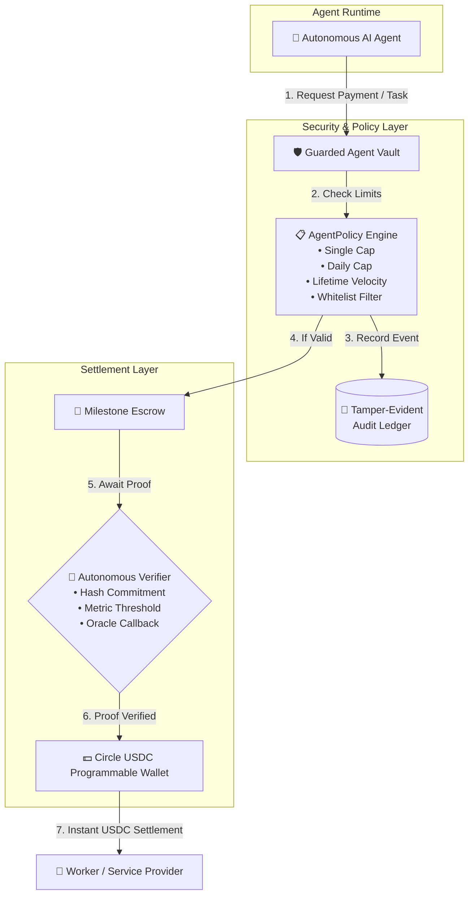

# ⚡ Arc USDC Agent Pay

[](https://github.com/Booshdag-io/arc-usdc-agent-pay/actions)
[](https://www.circle.com/usdc)
[](https://www.python.org/)
[](https://opensource.org/licenses/MIT)
[](https://github.com/psf/black)

**Production-grade Autonomous USDC Micro-Payment, Milestone Escrow & Cryptographic Audit Engine for AI Agents.**  
Engineered specifically for the **Circle Programmable Wallets** and **Arc** ecosystem.

---

## 🎯 The Core Problem

As autonomous AI agents evolve to hire other agents, consume paid APIs, buy datasets, and pay for decentralized computation, financial safety becomes the #1 blocker:
- ❌ **The Private Key Risk**: Giving an autonomous agent full access to a raw crypto wallet is catastrophic. A single hallucination, adversarial jailbreak prompt, or infinite loop can drain the wallet to $0.00 in seconds.
- ❌ **No Verifiable Milestone Protection**: Agents paying upfront get scammed; workers delivering computational work upfront risk non-payment.
- ❌ **Audit Blindness**: Traditional wallets log transactions on-chain, but lack application-level agent identity, task context, and verifiable integrity logs for enterprise compliance.

---

## 💡 The Solution: Arc USDC Agent Pay

`arc-usdc-agent-pay` introduces a modular, four-pillar financial operating system for autonomous agents:



---

## ✨ Key Capabilities

| Component | Description |
|---|---|
| **🛡️ Guarded Agent Vault** | Enforces hard spending bounds per-transaction, per-day (with automatic 24h reset), lifetime maximums, and recipient address whitelisting. |
| **🤝 Autonomous Milestone Escrow** | Locks funds on-chain in escrow until completion criteria are met. Supports automated settlement via cryptographic verifiers. |
| **🔎 Pluggable Task Verifiers** | Includes `HashVerifier` (SHA-256 commitment), `MinimumThresholdVerifier` (model accuracy/speed), and `CustomCallableVerifier`. |
| **🔗 Tamper-Evident Audit Ledger** | Cryptographically hash-chained transaction ledger (`prev_hash` &rarr; `current_hash`). Includes a zero-tampering validator (`verify_integrity()`). |
| **🔌 Circle Programmable Wallets Adapter** | Seamless developer-controlled wallet integration for Circle USDC with an offline mock mode for continuous integration (CI). |
| **💻 Interactive CLI (`arc-pay`)** | Manage vaults, test escrows, and audit transaction chains directly from the terminal. |

---

## 🚀 Quickstart

### Installation

```bash
git clone https://github.com/Booshdag-io/arc-usdc-agent-pay.git
cd arc-usdc-agent-pay
pip install -e .
```

### 1. Basic Guarded Vault Usage

```python
from decimal import Decimal
from src.core.vault import AgentVault, AgentPolicy

# Define safety guardrails
policy = AgentPolicy(
    max_single_payment=Decimal("5.00"),     # Max 5 USDC per API call
    daily_budget_limit=Decimal("25.00"),    # Max 25 USDC per 24 hours
    total_lifetime_cap=Decimal("100.00"),   # Hard cap on agent lifetime
    allowed_recipients=["0xTrustedProviderAddress..."]
)

# Initialize vault
vault = AgentVault(agent_id="researcher-agent-01", policy=policy)
vault.fund(Decimal("50.00"))

# Execute authorized payment
receipt = vault.authorize_and_pay(
    recipient="0xTrustedProviderAddress...",
    amount=Decimal("2.50"),
    memo="Vector search index query"
)

print("Payment Status:", receipt["status"])
print("Remaining Balance:", receipt["remaining_balance"], "USDC")
```

### 2. Autonomous Milestone Escrow with Hash Verification

```python
import hashlib
from decimal import Decimal
from src.core.escrow import MilestoneEscrow
from src.core.verifier import HashVerifier

# 1. Employer creates escrow with an expected SHA-256 artifact commitment
expected_data = b"Completed inference dataset v1"
expected_hash = hashlib.sha256(expected_data).hexdigest()

escrow = MilestoneEscrow()
milestone_id = escrow.create_milestone(
    employer_agent="agent-employer-01",
    worker="0xComputeNodeX",
    amount=Decimal("15.00"),
    criteria="Deliver completed dataset matching commitment",
    verifier=HashVerifier(expected_sha256=expected_hash)
)

# 2. Worker delivers proof -> escrow verifies autonomously & releases funds
result = escrow.submit_proof_and_verify(milestone_id, proof=expected_data)
print("Escrow Resolved:", result["status"])  # Output: RELEASED
```

### 3. Cryptographic Audit Chain Verification

```python
# Verify that no transaction in the agent's history has been tampered with
vault.ledger.verify_integrity()
print("Audit Ledger: 100% Verified. Zero tampering.")
```

---

## 💻 CLI Commands (`arc-pay`)

```bash
# Initialize an agent vault with guardrails
arc-pay vault-init --agent-id agent-001 --initial-fund 50.00 --max-single 10.00 --daily-limit 40.00

# Create an escrow milestone demo
arc-pay escrow-demo --employer agent-coordinator --worker agent-compute --amount 12.50

# Run cryptographic audit integrity check
arc-pay audit-verify
```

---

## 🧪 Running the Test Suite

```bash
# Run all unit tests with full coverage
pytest -v --cov=src --cov-report=term-missing
```

```
============================== 23 passed in 0.42s ==============================
```

---

## 🏗️ Project Architecture

```
arc-usdc-agent-pay/
├── .github/
│   └── workflows/
│       └── test.yml              # Multi-version Python CI/CD pipeline
├── src/
│   ├── core/
│   │   ├── vault.py              # Guarded budget vault & velocity policies
│   │   ├── escrow.py             # Milestone escrow engine
│   │   ├── verifier.py           # Pluggable task completion verifiers
│   │   └── ledger.py             # Tamper-evident cryptographic audit ledger
│   ├── adapters/
│   │   └── circle.py             # Circle Programmable Wallets client
│   └── cli/
│       └── main.py               # Command-line interface (`arc-pay`)
├── examples/
│   └── autonomous_agent_workflow.py  # End-to-end runnable agent demonstration
├── tests/
│   ├── test_vault.py
│   ├── test_escrow.py
│   ├── test_verifier.py
│   ├── test_ledger.py
│   ├── test_circle_adapter.py
│   └── test_cli.py
├── pyproject.toml
├── requirements.txt
├── LICENSE
└── README.md
```

---

## 🌐 Circle & Arc Ecosystem Alignment

`arc-usdc-agent-pay` is designed to be the foundational payment gateway for the **Arc Studio** agent network and **Circle Programmable Wallets**:
1. **Developer-Controlled Wallets**: Eliminates manual key management for server-side agents.
2. **CCTP Ready**: Native compatibility with Circle's Cross-Chain Transfer Protocol across Arc, Base, Ethereum, and Solana.
3. **Audit Compliance**: Enterprise-grade transaction logs for SOC2 and financial risk reporting.

---

## 👤 Author

**Booshdag**  
- GitHub: [@Booshdag-io](https://github.com/Booshdag-io)  
- X / Twitter: [@dtelles_88](https://x.com/dtelles_88)  

*Built with passion for autonomous agent economies and open-source financial safety.*
